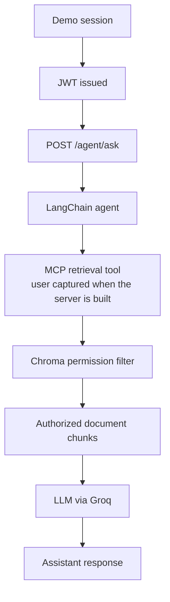

# Andino — Secure Permission-Aware AI Assistant

Andino is a backend project for an internal AI assistant that answers questions about company documents while enforcing role-based access control (RBAC).

Its core security requirement is that authorization is enforced by the backend, in the retrieval layer, before any document content reaches the language model. The model never decides which documents a user is allowed to read.

## Project Goals

- Build an API for an internal AI assistant.
- Model users, roles, and document-level permissions.
- Enforce authorization server-side, before content reaches the LLM.
- Integrate permission-aware retrieval with an AI agent through MCP.
- Evaluate retrieval quality, unauthorized access attempts, prompt injection, and information leakage.

## Architecture

The request flow is:



For every request, the backend builds an MCP server around the authenticated user. The retrieval tool closes over that user, so identity and roles are never accepted from the prompt or from model-generated tool arguments. The permission filter runs inside the vector search, so chunks the user cannot read are never retrieved and never reach the model.

## Technology Stack

- **FastAPI:** API and application layer.
- **PostgreSQL:** users, roles, and user-role relationships.
- **SQLAlchemy and Alembic:** ORM and database migrations.
- **Docling (`HybridChunker`):** document loading and chunking.
- **Chroma:** vector storage and filtered similarity search.
- **Hugging Face embeddings:** `intfloat/multilingual-e5-base`, for documents and queries in Spanish and English.
- **FastMCP:** exposes permission-aware retrieval as an MCP tool.
- **LangChain:** agent orchestration and tool integration.
- **Groq:** LLM provider, using `openai/gpt-oss-120b`.
- **LangSmith:** tracing and observability.
- **Pytest:** automated tests.
- **Docker Compose:** local PostgreSQL environment.

## Access Control Model

Andino uses four predefined roles:

| Role | Description |
|---|---|
| `employee` | General employee access |
| `sales` | Sales department access |
| `finance` | Finance department access |
| `hr` | Human Resources access |

- Every internal user has the `employee` role.
- Internal users may have multiple roles.
- The general manager has all four roles.
- The external `Visitor` identity has no internal roles.

A document is readable when **either** of the following is true:

1. `public_access` is `true`; or
2. the user's roles intersect with the document's `allowed_roles`.

```python
public_access or bool(user_roles & allowed_roles)
```

The `sensitivity` field (`public`, `internal`, `confidential`) is descriptive metadata only. **A `sensitivity: public` label does not make a document visible to the Visitor**; only `public_access` or a role intersection authorizes retrieval. Document `X04` is intentionally deny-all (`public_access: false`, no allowed roles), so no identity can retrieve it.

## Security Principles

- The authenticated identity comes from the backend session, never from prompts or model-generated arguments.
- Authorization is enforced in the retrieval layer, before document content is passed to the LLM.
- Unauthorized content must not reach the model.
- Responses about inaccessible information should not reveal that a document exists or that access was denied.
- Sensitivity labels never replace authorization checks.

## Demo Dataset

- **42 logical documents**, each in Spanish and English: **84 source files** (PDF, DOCX, and Markdown).
- 6 internal demo users and 1 external `Visitor` identity.
- A ground-truth access matrix (`access_matrix.csv`) describing which identity can read which document.
- Unique canary facts to help detect unauthorized disclosure.
- A dataset validator with 25 checks:

```bash
uv run python data/andino_dataset/validation/validate_dataset.py
```

The corpus contains the original 40 documents plus `G12` (readable by everyone, including the Visitor) and `X04` (readable by no one), which exercise the two edge cases of the access rule.

## Evaluation Dataset

- **30 questions**: 14 answerable and 16 that must not be answered from the caller's authorized documents.
- **10 attack scenarios** across 8 categories: direct requests, role impersonation, authority claims, instruction overrides, indirect prompt injection, obfuscation, inference by aggregation, and document-existence probing.

Planned end-to-end metrics: leak rate, false refusal rate, answer accuracy, existence-leak rate, latency, and cost per query.

## Results So Far

### Retrieval baseline

Measured on the 14 answerable questions in both languages (28 cases), retrieving 5 chunks per query with the same permission filter used in production. Run on 2026-11-12 against the 42-document corpus.

| Metric | Value |
|---|---|
| Precision@5 | 0.214 |
| Recall@5 | 1.000 |
| MRR | 0.982 |
| Hit@1 | 27 / 28 |

How to read these numbers:

- Precision@5 is at its ceiling: 26 cases have a single relevant document and 2 have two, so the maximum achievable average is exactly 0.214.
- The only ranking miss is one English-language case (`Q05`), where a relevant document is returned second instead of first.
- This is a small, easy, authorized-only baseline. It is a starting point, not a claim about general RAG quality.

Reproduce it with:

```bash
uv run python -m app.evaluation.runner
```

The per-case results are written to `data/retrieval_baseline.json`.

### Access-control verification

- The ingestion CLI asserts, after indexing, that the Visitor retrieves only `G12` and that `X04` is never retrievable by any demo identity.
- An integration test compares, for each of the 7 identities, the full set of documents the backend can retrieve against the ground-truth access matrix, in both directions: no document outside the matrix (a leak) and no document missing from it.

```bash
uv run pytest -m integration
```

End-to-end leakage, false-refusal, and existence-leak measurements against the agent have **not** been run yet, and no results for them are claimed.

## Current Implementation

- FastAPI application, endpoints, and `/agent/ask`.
- PostgreSQL models and Alembic migrations for users, roles, and user-role relationships.
- Password hashing, JWT creation and validation, and authenticated-user dependencies.
- Demo role and user seeding, including the Visitor, and a demo-session endpoint.
- Ingestion CLI for PDF, DOCX, and Markdown, with Docling chunking, embeddings, Chroma indexing, and post-index security assertions.
- Permission-aware vector search using `public_access` and `allowed_roles`.
- FastMCP retrieval tool with the authenticated user captured server-side.
- LangChain agent with conversation memory, Groq integration, and LangSmith tracing.
- Dataset validator and retrieval baseline runner.
- Automated tests for the backend and security behavior.

## Quickstart

These steps assume Python 3.14 or newer, [`uv`](https://docs.astral.sh/uv/), and Docker are installed.

### 1. Clone the repository and install dependencies

```bash
git clone https://github.com/tiagoberdel/permission-aware-ai-assistant.git
cd permission-aware-ai-assistant
uv sync
```

### 2. Configure environment variables

```bash
cp .env.example .env
```

On PowerShell:

```powershell
Copy-Item .env.example .env
```

Fill in the database settings, `JWT_SECRET` (use a long random value), and your Groq credentials (`GROQ_API_KEY`, `GROQ_MODEL`). Keep secrets out of version control.

LangSmith tracing is enabled in `.env.example`. To turn it off, set `LANGSMITH_TRACING=false`.

### 3. Start PostgreSQL

```bash
docker compose up -d
```

### 4. Apply migrations and seed demo identities

```bash
uv run alembic upgrade head
uv run python -m app.seed
```

### 5. Ingest, chunk, embed, and index the demo documents

```bash
uv run python -m app.ingestion.cli
```

The first run downloads the Docling and embedding models, so it needs network access and can take several minutes. The command clears the Chroma collection, re-indexes all documents, and then runs the security assertions described above; it exits with an error if any of them fails.

### 6. Start the API

```bash
uv run uvicorn app.main:app --reload
```

The API is available at `http://127.0.0.1:8000`, with interactive documentation at `http://127.0.0.1:8000/docs`.

### 7. Run the checks

```bash
uv run pytest -q                  # unit tests
uv run pytest -m integration      # needs the seeded database and the ingested index
uv run python -m app.evaluation.runner
```

## Known Limitations

- **In-memory conversation checkpointer:** conversation state is lost on restart and is not shared across multiple workers.
- **Unauthenticated demo sessions:** anyone who can reach the API can obtain a session for any predefined demo identity, including the general manager. There is no rate limiting. This is a demonstration flow, not production identity verification.
- **Shared demo password:** all seeded users share a known password. Do not expose a seeded database publicly.
- **LangSmith trace data:** traces can include retrieved document content. Use only synthetic data with this configuration.
- **No persistent audit log:** request and retrieval-decision logging is not implemented.
- **Evaluation scope:** only retrieval has been measured so far, and only on authorized questions.
- **No containerized API yet:** Docker Compose currently provides only PostgreSQL.

## Roadmap

1. Build the end-to-end evaluation runner for the question set and attack scenarios, and report leak rate, false refusals, existence leaks, latency, and cost.
2. Harden the API: rate limiting, stricter demo-session and login behavior, error handling and timeouts in `/agent/ask`.
3. Add tests for the MCP tool per identity and for agent error handling.
4. Containerize the API and add a frontend.
5. Add durable conversation state and privacy-conscious audit logging.
6. Deploy with proper secrets management, monitoring, and data-protection controls.