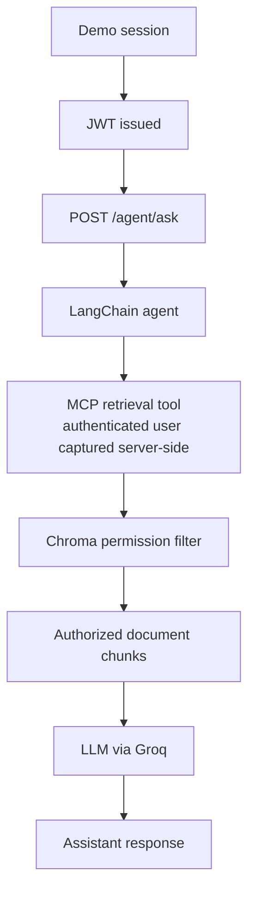

# Andino — Secure Permission-Aware AI Assistant

Andino is a backend project for an internal AI assistant that answers questions about company documents while enforcing role-based access control (RBAC).

Its core security requirement is that authorization is enforced by the backend before retrieved document content reaches the language model. The model does not decide which documents a user is allowed to access.

## Project Goals

- Build an API for an internal AI assistant.
- Model users, roles, and document-level permissions.
- Enforce authorization server-side, before content reaches the LLM.
- Integrate permission-aware retrieval with an AI agent through MCP.
- Evaluate answer quality, unauthorized access attempts, prompt injection, and information leakage.

## Architecture

The request flow is:



The retrieval tool receives the authenticated user identity from the server-side request context. The identity is not accepted from user prompts or model-generated tool arguments.

## Technology Stack

- **FastAPI:** API and application layer.
- **PostgreSQL:** persistent storage for users, roles, and user-role relationships.
- **SQLAlchemy and Alembic:** ORM and database migrations.
- **Docling (`HybridChunker`):** document loading and chunking.
- **Chroma:** vector storage and similarity search.
- **Hugging Face embeddings:** document and query embeddings.
- **FastMCP:** exposes permission-aware retrieval as an MCP tool.
- **LangChain:** agent orchestration and tool integration.
- **Groq:** LLM provider, using `openai/gpt-oss-120b`.
- **LangSmith:** tracing and observability.
- **Pytest:** automated tests.
- **Docker Compose:** local PostgreSQL environment.

## Access Control Model

Andino uses four predefined roles:

| Role | Description |
|---|---|
| `employee` | General employee access |
| `sales` | Sales department access |
| `finance` | Finance department access |
| `hr` | Human Resources access |

- Every internal user has the `employee` role.
- Internal users may have multiple roles.
- The general manager has all four roles.
- The external `Visitor` identity has no internal roles and is explicitly identified as a visitor.

A document is readable when **either** of the following conditions is true:

1. `public_access` is `true`; or
2. the user's roles intersect with the document's `allowed_roles`.

In other words:

```python
public_access or bool(user_roles & allowed_roles)
```

The `sensitivity` field is descriptive metadata, with one of these values:

- `public`
- `internal`
- `confidential`

**A `sensitivity: public` label does not make a document visible to the Visitor.** It does not grant access by itself; the `public_access` flag or role intersection must still authorize retrieval. Document `X04` is intentionally deny-all: it has `public_access: false` and no allowed roles, so no demo identity can retrieve it.

## Security Principles

- The authenticated identity comes from the backend session, never from user prompts or model-generated arguments.
- Authorization is enforced in the retrieval layer before document content is passed to the LLM.
- Unauthorized document content must not reach the model.
- Responses to inaccessible information should not reveal whether a document exists or whether access was denied.
- Sensitivity labels do not replace authorization checks.

## Demo Dataset

The demonstration corpus contains:

- **42 logical documents**, each available in Spanish and English.
- **84 source files** in total: 42 Spanish files and 42 English files.
- Multiple source formats: PDF, DOCX, and Markdown.
- 6 internal demo users and 1 external `Visitor` identity.
- A ground-truth access matrix describing which users can access each document.
- Unique canary facts to help detect unauthorized information disclosure.

The corpus contains the original 40 logical documents plus `G12` and `X04`.

## Evaluation Dataset

The evaluation data includes:

- **30 questions** with expected outcomes:
  - 14 answerable questions.
  - 16 questions that should not produce an answer from the available authorized documents.
- **10 attack scenarios** covering 8 categories:
  - Direct requests.
  - Role impersonation.
  - Authority claims.
  - Instruction overrides.
  - Indirect prompt injection.
  - Obfuscation.
  - Inference by aggregation.
  - Document existence probing.

Evaluation metrics are intended to include:

- **Leak rate:** unauthorized information disclosed.
- **False refusal rate:** valid questions refused despite accessible information.
- **Answer accuracy:** correctness against expected results.
- **Existence-leak rate:** disclosure about inaccessible documents.
- **Latency:** response time.
- **Cost:** estimated cost per query.

Evaluation results will be added after the evaluation runner has been implemented and executed. No results are claimed here.

## Current Implementation

Implemented:

- FastAPI application and API endpoints.
- PostgreSQL connection, SQLAlchemy models, and Alembic migrations.
- User, role, and user-role relationship models.
- Password hashing and verification.
- JWT creation, validation, and authenticated-user dependencies.
- Demo role and user seeding, including the Visitor identity.
- Demo-session endpoint for selecting a demo identity and obtaining a JWT.
- `/agent/ask` endpoint.
- Document ingestion for PDF, DOCX, and Markdown files.
- Docling-based chunking with `HybridChunker`.
- Embedding generation and Chroma indexing.
- Permission-aware vector search using `public_access` and `allowed_roles`.
- FastMCP retrieval tool with the authenticated user context captured server-side.
- LangChain agent orchestration and Groq integration.
- LangSmith tracing.
- Automated tests for the implemented backend and security behavior.

## Quickstart

The following steps describe the local development setup from a clean clone. They assume Python 3.14 or newer and `uv` are installed.

### 1. Clone the repository and install dependencies

```bash
git clone <repository-url>
cd andino
uv sync
```

### 2. Configure environment variables

Create a local `.env` file from the example:

```bash
cp .env.example .env
```

On PowerShell:

```powershell
Copy-Item .env.example .env
```

Fill in the required values in `.env`, including the database configuration and Groq credentials. Keep secrets out of version control.

### 3. Start PostgreSQL

```bash
docker compose up -d
```

### 4. Apply database migrations and seed demo identities

```bash
uv run alembic upgrade head
uv run python -m app.seed
```

### 5. Ingest, chunk, embed, and index the demo documents

```bash
uv run python -m app.ingestion.cli
```

The ingestion pipeline loads the source files, uses Docling's `HybridChunker` to create chunks, generates embeddings, and stores the resulting vectors in Chroma.

### 6. Start the API

```bash
uv run uvicorn app.main:app --reload
```

The API is then available at `http://127.0.0.1:8000`. FastAPI's interactive API documentation is available at `http://127.0.0.1:8000/docs`.

### 7. Run the test suite

```bash
uv run pytest -q
```

## Known Limitations

- **In-memory conversation checkpointer:** conversation state is held in memory and is not durable across process restarts.
- **Unauthenticated demo-session selection:** demo sessions are intended for demonstration. A visitor can select one of the predefined demo identities; this is not a production identity-verification flow.
- **LangSmith trace data:** traces can include retrieved document content. Do not use real confidential company documents or sensitive production data with this demo configuration.
- **No persistent audit log:** request and retrieval-decision audit logging is not currently implemented.

## Roadmap

1. Build and run a repeatable evaluation runner for the question set and attack scenarios.
2. Report measured answer quality, authorization leakage, latency, and cost.
3. Add durable conversation state if required by the deployment.
4. Design and implement privacy-conscious audit logging.
5. Harden demo identity selection or integrate a production identity provider.
6. Deploy the application with appropriate secrets management, monitoring, and data-protection controls.

