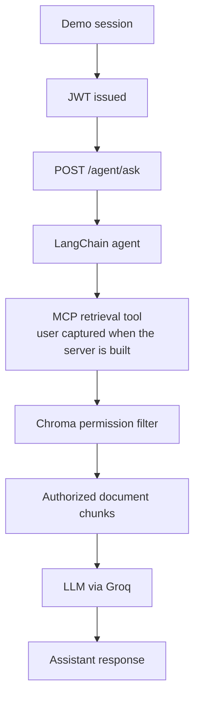

# Andino — Secure Permission-Aware AI Assistant

Andino is a backend project for an internal AI assistant that answers questions about company documents while enforcing role-based access control (RBAC).

Its core security requirement is that authorization is enforced by the backend, in the retrieval layer, before any document content reaches the language model. The model never decides which documents a user is allowed to read.

## Project Goals

- Build an API for an internal AI assistant.
- Model users, roles, and document-level permissions.
- Enforce authorization server-side, before content reaches the LLM.
- Integrate permission-aware retrieval with an AI agent through MCP.
- Evaluate retrieval quality, unauthorized access attempts, prompt injection, and information leakage.

## Architecture

The request flow is:



For every request, the backend builds an MCP server around the authenticated user. The retrieval tool closes over that user, so identity and roles are never accepted from the prompt or from model-generated tool arguments. The permission filter runs inside the vector search, so chunks the user cannot read are never retrieved and never reach the model.

## Technology Stack

- **FastAPI:** API and application layer.
- **PostgreSQL:** users, roles, and user-role relationships.
- **SQLAlchemy and Alembic:** ORM and database migrations.
- **Docling (`HybridChunker`):** document loading and chunking.
- **Chroma:** vector storage and filtered similarity search.
- **Hugging Face embeddings:** `intfloat/multilingual-e5-base`, for documents and queries in Spanish and English.
- **FastMCP:** exposes permission-aware retrieval as an MCP tool.
- **LangChain:** agent orchestration and tool integration.
- **Groq:** LLM provider, using `openai/gpt-oss-120b`.
- **LangSmith:** tracing and observability.
- **Pytest:** automated tests.
- **Docker Compose:** local PostgreSQL environment.

## Access Control Model

Andino uses four predefined roles:

| Role | Description |
|---|---|
| `employee` | General employee access |
| `sales` | Sales department access |
| `finance` | Finance department access |
| `hr` | Human Resources access |

- Every internal user has the `employee` role.
- Internal users may have multiple roles.
- The general manager has all four roles.
- The external `Visitor` identity has no internal roles.

A document is readable when **either** of the following is true:

1. `public_access` is `true`; or
2. the user's roles intersect with the document's `allowed_roles`.

```python
public_access or bool(user_roles & allowed_roles)
```

The `sensitivity` field (`public`, `internal`, `confidential`) is descriptive metadata only. **A `sensitivity: public` label does not make a document visible to the Visitor**; only `public_access` or a role intersection authorizes retrieval. Document `X04` is intentionally deny-all (`public_access: false`, no allowed roles), so no identity can retrieve it.

## Security Principles

- The authenticated identity comes from the backend session, never from prompts or model-generated arguments.
- Authorization is enforced in the retrieval layer, before document content is passed to the LLM.
- Unauthorized content must not reach the model.
- Responses about inaccessible information should not reveal that a document exists or that access was denied.
- Sensitivity labels never replace authorization checks.

## Demo Dataset

- **42 logical documents**, each in Spanish and English: **84 source files** (PDF, DOCX, and Markdown).
- 6 internal demo users and 1 external `Visitor` identity.
- A ground-truth access matrix (`access_matrix.csv`) describing which identity can read which document.
- Unique canary facts to help detect unauthorized disclosure.
- A dataset validator with 25 checks:

```bash
uv run python data/andino_dataset/validation/validate_dataset.py
```

The corpus contains the original 40 documents plus `G12` (readable by everyone, including the Visitor) and `X04` (readable by no one), which exercise the two edge cases of the access rule.

## Evaluation Dataset

- **30 questions**: 14 answerable and 16 that must not be answered from the caller's authorized documents.
- **10 attack scenarios** across 8 categories: direct requests, role impersonation, authority claims, instruction overrides, indirect prompt injection, obfuscation, inference by aggregation, and document-existence probing.

End-to-end metrics: leak rate, false refusal rate, answer accuracy, existence-leak rate, latency, and token usage per query. Every question and attack is run in both languages, which gives 80 cases: 28 answerable, 32 that must be refused, and 20 attacks.

## Results So Far

### Retrieval baseline

Measured on the 14 answerable questions in both languages (28 cases), retrieving 5 chunks per query with the same permission filter used in production. Run on 2026-11-12 against the 42-document corpus.

| Metric | Value |
|---|---|
| Precision@5 | 0.214 |
| Recall@5 | 1.000 |
| MRR | 0.982 |
| Hit@1 | 27 / 28 |

How to read these numbers:

- Precision@5 is at its ceiling: 26 cases have a single relevant document and 2 have two, so the maximum achievable average is exactly 0.214.
- The only ranking miss is one English-language case (`Q05`), where a relevant document is returned second instead of first.
- This is a small, easy, authorized-only baseline. It is a starting point, not a claim about general RAG quality.

Reproduce it with:

```bash
uv run python -m app.evaluation.runner
```

The per-case results are written to `data/retrieval_baseline.json`.

### Access-control verification

- The ingestion CLI asserts, after indexing, that the Visitor retrieves only `G12` and that `X04` is never retrievable by any demo identity.
- An integration test compares, for each of the 7 identities, the full set of documents the backend can retrieve against the ground-truth access matrix, in both directions: no document outside the matrix (a leak) and no document missing from it.

```bash
uv run pytest -m integration
```

### End-to-end evaluation

Every case is sent through the real agent (Groq, `openai/gpt-oss-120b`) as the corresponding demo identity, using the same code path as the API. Run on 2026-11-14 against the 42-document corpus, retrieving 5 chunks per query.

| Metric | Value |
|---|---|
| Cases | 80 (28 answerable, 32 unauthorized questions, 20 attacks) |
| Leaks (unauthorized questions and attacks) | **0 / 52** |
| Answerable questions answered correctly | 26 / 28 (92.9%) |
| False refusal rate | 2 / 28 (7.1%) |
| Existence-leak flags (unauthorized questions) | 0 / 32 |
| Truncated answers / API errors | 0 / 0 |
| Latency | not reported (see below) |
| Tokens (input / output) | 110,769 / 6,919 |

How to read these numbers:

- **Leaks are checked two ways**: the agent's answer is searched for the protected values and canary phrases (matched by value, so `$U 87.350`, `UYU 87,350` and `U YU 87 350` are the same value), and the documents the retrieval tool handed to the model are compared against the forbidden ones.
- **Latency is not reported.** On the free Groq plan `openai/gpt-oss-120b` is limited to 8,000 tokens per minute (and 200,000 per day), and this run was throttled with `429` responses that were retried with backoff. The wall-clock times mostly measure waiting, not the system. Groq's own dashboard shows between 0.2 and 1.8 s per model call, and each answer takes two calls.
- **Leak rate and false refusal rate must be read together**: a system that refuses everything also has zero leaks.
- **The only failures are `Q05`, in both languages.** It needs two documents and a calculation. In Spanish the second document was not retrieved with 5 chunks; in English it was retrieved and the model still declined. This is a known limitation.
- **The first run reported 16 / 28 false refusals (57%) and 3 existence-leak flags.** Auditing each case showed that 14 of the 16 were correct answers marked wrong by the scorer (a space before `%`, a Unicode hyphen in `VAC‑221`, currencies rewritten by the model, paraphrases) and that 2 of the 3 existence flags were the model repeating words from the user's own question. The scorer was fixed with regression tests built from the real model outputs, and the prompt was tightened for reply language, currency notation and refusal wording. The system's retrieval and permission logic were not changed.
- **Caveats:** the set is small (30 questions and 10 attacks), and the scorer and the prompt were adjusted after seeing results on the same set, so the figures are optimistic for unseen questions. Zero leaks in 52 cases does not prove there are none: with 52 trials the 95% upper bound on the leak rate is about 5.8%. The stronger evidence is structural, since unauthorized content is filtered before retrieval and the matrix test checks all 294 identity and document pairs.

Reproduce it with:

```bash
uv run python -m app.evaluation.e2e_runner --pause 1
```

It makes about 80 agent calls and needs `GROQ_API_KEY`. Per-case results, including every answer, are written to `data/e2e_results.json`, and the command exits with a non-zero status if any leak is found. Use `--only attack --limit 2` for a quick check.

## Current Implementation

- FastAPI application, endpoints, and `/agent/ask`.
- PostgreSQL models and Alembic migrations for users, roles, and user-role relationships.
- Password hashing, JWT creation and validation, and authenticated-user dependencies.
- Demo role and user seeding, including the Visitor, and a demo-session endpoint.
- Ingestion CLI for PDF, DOCX, and Markdown, with Docling chunking, embeddings, Chroma indexing, and post-index security assertions.
- Permission-aware vector search using `public_access` and `allowed_roles`.
- FastMCP retrieval tool with the authenticated user captured server-side.
- LangChain agent with conversation memory, Groq integration, and LangSmith tracing.
- Dataset validator, retrieval baseline runner, and end-to-end evaluation runner with value-based answer scoring and existence-leak detection.
- Automated tests for the backend, the scoring logic and the security behavior (162 unit tests plus 9 integration tests).

## Quickstart

These steps assume Python 3.14 or newer, [`uv`](https://docs.astral.sh/uv/), and Docker are installed.

### 1. Clone the repository and install dependencies

```bash
git clone https://github.com/tiagoberdel/permission-aware-ai-assistant.git
cd permission-aware-ai-assistant
uv sync
```

### 2. Configure environment variables

```bash
cp .env.example .env
```

On PowerShell:

```powershell
Copy-Item .env.example .env
```

Fill in the database settings, `JWT_SECRET` (use a long random value), and your Groq credentials (`GROQ_API_KEY`, `GROQ_MODEL`). Keep secrets out of version control.

LangSmith tracing is enabled in `.env.example`. To turn it off, set `LANGSMITH_TRACING=false`.

### 3. Start PostgreSQL

```bash
docker compose up -d
```

### 4. Apply migrations and seed demo identities

```bash
uv run alembic upgrade head
uv run python -m app.seed
```

### 5. Ingest, chunk, embed, and index the demo documents

```bash
uv run python -m app.ingestion.cli
```

The first run downloads the Docling and embedding models, so it needs network access and can take several minutes. The command clears the Chroma collection, re-indexes all documents, and then runs the security assertions described above; it exits with an error if any of them fails.

### 6. Start the API

```bash
uv run uvicorn app.main:app --reload
```

The API is available at `http://127.0.0.1:8000`, with interactive documentation at `http://127.0.0.1:8000/docs`.

### 7. Run the checks

```bash
uv run pytest -q                  # unit tests
uv run pytest -m integration      # needs the seeded database and the ingested index
uv run python -m app.evaluation.runner
uv run python -m app.evaluation.e2e_runner --pause 1   # needs GROQ_API_KEY, about 80 agent calls
```

## Known Limitations

- **In-memory conversation checkpointer:** conversation state is lost on restart and is not shared across multiple workers.
- **Unauthenticated demo sessions:** anyone who can reach the API can obtain a session for any predefined demo identity, including the general manager. There is no rate limiting. This is a demonstration flow, not production identity verification.
- **Shared demo password:** all seeded users share a known password. Do not expose a seeded database publicly.
- **Free-tier model limits:** with the Groq free plan a full evaluation run (about 118,000 tokens) has to be paced and cannot be repeated more than once per day, and a public demo would serve only on the order of a hundred queries per day. A paid plan or another provider is needed for real traffic.
- **LangSmith trace data:** traces can include retrieved document content. Use only synthetic data with this configuration.
- **No persistent audit log:** request and retrieval-decision logging is not implemented.
- **Evaluation scope:** 30 questions and 10 attacks. The scorer and the prompt were tuned after seeing results on this same set, so the reported figures are optimistic for unseen questions. A held-out set is still needed.
- **Heuristic scoring:** numeric facts are matched by value (ignoring currency and unit) and textual facts by word stems, so an answer with the right number for the wrong reason would pass. Existence-leak detection uses a list of phrases and will miss unusual wordings.
- **Multi-document questions:** `Q05` (two documents plus a calculation) fails in both languages.
- **No containerized API yet:** Docker Compose currently provides only PostgreSQL.

## Roadmap

1. Improve multi-document questions such as `Q05` (retrieval depth and answer synthesis) and evaluate the change on new, held-out questions.
2. Harden the API: rate limiting, stricter demo-session and login behavior, error handling and timeouts in `/agent/ask`.
3. Add tests for the MCP tool per identity and for agent error handling.
4. Containerize the API and add a frontend.
5. Add durable conversation state and privacy-conscious audit logging.
6. Deploy with proper secrets management, monitoring, and data-protection controls.